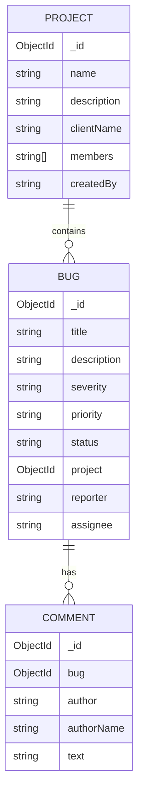

# Gradious Bug Tracking System

A tool for Gradious engineering teams to track, assign and resolve bugs in student or client projects.

**Stack:** React (Vite) · Node.js + Express · MongoDB (Mongoose)

## Features

- Three roles: **Admin**, **Developer**, **Reporter**
- Projects for student or client work, with developer members (admin manages them)
- Bugs with severity, priority and a status workflow: Open → In Progress → In Review → Resolved → Closed
- Assign bugs to developers (admin), change status (assignee or admin)
- Comment thread on every bug
- Search, filters (project, status, severity, assignee) and pagination
- Dashboard: bugs by status and severity, bugs assigned to me, and a Report a bug button

## Who can do what

| Action | Admin | Developer | Reporter |
|---|---|---|---|
| View projects, bugs, comments | Yes | Yes | Yes |
| Create, edit, delete projects | Yes | No | No |
| Report a bug | Yes | Yes | Yes |
| Edit bug details | Yes | Only own reports | Only own reports |
| Assign a bug | Yes | No | No |
| Change bug status | Yes | Only if assigned to them | No |
| Delete a bug | Yes | No | No |
| Add comments | Yes | Yes | Yes |

The server enforces these rules. The UI also hides buttons a user cannot use.

## Setup

**Requirements:** Node 20+, a MongoDB Atlas cluster (or local MongoDB).

```bash
# 1. Server
cd server
cp .env.example .env      # then put your real MONGO_URI in .env
npm install
npm run seed              # adds 5 demo projects with bugs; never deletes anything
npm run dev               # http://localhost:5000

# 2. Client (new terminal)
cd client
cp .env.example .env      # VITE_API_URL=http://localhost:5000/api
npm install
npm run dev               # http://localhost:5173
```

## Demo projects

`npm run seed` adds these projects (with sample bugs) where bug reports can be created:

1. Student Portal
2. Practice Problems
3. Mock Tests
4. Doubts Forum
5. Jobs & Internships

The seed skips any project whose name already exists, so it is safe to run again. All data is stored in MongoDB, so it stays after the app or server is closed.

## Demo accounts

| Role | Email | Password |
|---|---|---|
| Admin | admin@gradious.com | admin123 |
| Developer | dev1@gradious.com | dev123 |
| Developer | dev2@gradious.com | dev123 |
| Reporter | reporter@gradious.com | rep123 |

The login page also has quick-login buttons for these accounts.

## Project structure

```
server/
  server.js                  start-up: load env, connect DB, listen
  src/
    app.js                   middleware and route mounting
    config/db.js             MongoDB connection
    data/users.js            static demo users
    middleware/              auth (identifyUser, authorize), errorHandler
    models/                  Project, Bug, Comment
    controllers/             project, bug, comment, dashboard
    routes/                  user, project, bug, dashboard
    seed.js                  demo data script
client/src/
  api/                       axios instance (adds x-user-id header)
  context/ + hooks/          AuthProvider, useAuth, useFetch, useDebounce, useUsers
  components/                Layout, Navbar, ProtectedRoute, Badge, Status
  features/                  auth, dashboard, projects, bugs
  utils/constants.js         statuses, severities, helpers
```

## Data model



Users are not stored in MongoDB. `reporter`, `assignee`, `members` and `author` hold ids from the static list in `server/src/data/users.js` (`u1` to `u4`).

## API

All routes except `/api/health` and `/api/users/login` need the header `x-user-id`.

| Method | Route | Access |
|---|---|---|
| GET | /api/health | public |
| POST | /api/users/login | public |
| GET | /api/users | public |
| GET | /api/users/me | logged in |
| GET, POST | /api/projects | list: all, create: admin |
| GET, PUT, DELETE | /api/projects/:id | read: all, write: admin |
| GET | /api/bugs?project=&status=&severity=&assignee=&q=&page=&limit= | all |
| POST | /api/bugs | all |
| GET, PUT | /api/bugs/:id | read: all, edit: admin or reporter |
| PATCH | /api/bugs/:id/assign | admin |
| PATCH | /api/bugs/:id/status | admin or assignee |
| DELETE | /api/bugs/:id | admin |
| GET, POST | /api/bugs/:id/comments | all |
| GET | /api/dashboard/stats | all |

Deleting a project also deletes its bugs and their comments. Deleting a bug deletes its comments.

## Demo script (5 minutes)

1. Log in as **Reporter**, report a bug in "Student Portal".
2. Log in as **Admin**, open the bug and assign it to Dev One.
3. Log in as **Developer** (Dev One), open it, set status to In Progress, add a comment, then set Resolved.
4. As **Admin**, show the dashboard and the search and filters on the Bugs page.
5. Mention the known limitations below.

## Known limitations

- **No real authentication.** Users are a fixed list, passwords are plain text, and the browser sends `x-user-id`, which anyone could forge. A production version would use hashed passwords in the database and JWT or sessions.
- No file attachments, email notifications or audit log.
- No automated tests.
- Status can move between any two states (no enforced order).
